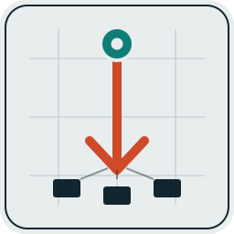
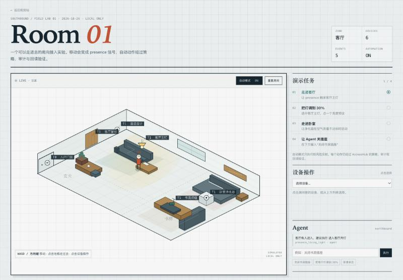

<p align="center">
  
</p>

<h1 align="center">Southbound</h1>

<p align="center"><strong>本地优先的 IoT Agent 南向接入层</strong></p>

<p align="center">
  
  
  
  
</p>

<p align="center">
  <a href="docs/DEMO.md">演示</a> ·
  <a href="docs/ARCHITECTURE.md">架构</a> ·
  <a href="docs/ACCESS_LAYER.md">接入层</a> ·
  <a href="docs/ONBOARDING.md">受控接入</a> ·
  <a href="docs/PROTOCOL.md">协议</a> ·
  <a href="docs/ABOUT.md">About</a> ·
  <a href="CONTRIBUTING.md">贡献</a>
</p>

> **命名**：品牌与文档统一写作 **Southbound**；`southbound` 是 Python 包名、CLI 命令与仓库 slug 的技术标识。

发现局域网设备 → 判断端侧能力 → 受控接入 → 用统一工具调用真实或虚拟设备。

`Southbound` 取 IoT/电信架构里的 *southbound interface*：北向接口面向应用与 agent，南向接口面向设备。这个项目就是 agent 与设备之间的那一层。


## 为什么是 Southbound

大多数“智能家居 agent”直接绑定一个平台或一种协议：Home Assistant、Matter、Zigbee、厂商云。Southbound 不重复做平台，而是做 **agent 的南向访问层**：

- 设备以 `DeviceBinding` 的形式存在；
- 能力以 `Capability` 暴露；
- agent 只调用 `iot_call(device_id, capability, arguments)`；
- 策略、审计、参数校验、协议适配都在工具层完成。

它也不是：

- 一个 Home Assistant 替代品（HA 可以作为 adapter）；
- 一个漏洞利用/自传播工具（明确不做）；
- 一个已经过生产认证的控制系统（Alpha）。

更完整的产品定位、命名由来与边界见 [docs/ABOUT.md](docs/ABOUT.md)。

## 核心能力

| 能力 | 说明 |
|---|---|
| **局域网发现** | ARP + mDNS + SSDP，支持 `/23` 等非 `/24` 网段，mDNS 实例解析到 IP |
| **T0–T3 分级** | 厂商 OUI、服务类型、端口指纹，判断设备能跑什么级别的 agent |
| **接入工具层** | DeviceBinding / Capability / Risk / Tool Catalog / JSON Schema 参数校验 |
| **策略与审计** | read_only / supervised / autonomous；每次调用写 JSONL 审计 |
| **受控 onboarding** | 发现 → 授权 → 绑定 adapter/策略 → 工具目录；支持撤销与持久化 |
| **多协议 adapter** | Simulator、Home Assistant REST、MQTT、Zigbee2MQTT |
| **运行时与事件流** | SouthboundRuntime + EventBus + SSE；面板实时显示 northbound/southbound |
| **2.5D 房间实验** | `GET /scene`：可移动 avatar、presence 信号、点击设备、自动反射与回读验证 |
| **可视化** | 网络拓扑、设备清单、模拟端点、Agent 控制台、接入表单 |
| **MCP** | 15 个工具：发现、深扫、模拟器、接入层、受控 onboarding |
| **无硬件闭环** | 六个虚拟端点 + 确定性 agent trace，没有设备也能跑 |

## 60 秒 Demo

```bash
git clone https://github.com/alexyyyander/southbound.git
cd southbound
python3 -m southbound serve
```

打开 `http://127.0.0.1:8765/`：

1. 在 Agent 控制台输入 `打开客厅灯并关掉书房插座`；
2. 顶部 flowbar 出现 `intent → command → state → result`；
3. 点击“模拟端点”下方的 **＋ 接入设备**，提交一个虚拟传感器；
4. 新端点出现在面板，可以继续控制或点“移除”撤销。

然后打开 `http://127.0.0.1:8765/scene` 进入 **2.5D 房间实验**：

1. 用 WASD / 方向键或点击地板移动，走进客厅会触发 presence 信号与自动开灯；
2. 点击房间里的设备，用 30% 亮度预设完成任务；
3. 走进卧室，观察净化器在空气质量不达标时自动启动并回读验证；
4. 在 Agent 面板输入“关闭书房插座”，对比 northbound 意图与 southbound 事件。



也可以直接命令行：

```bash
python3 -m southbound intent "把客厅灯调到 35% 并打开窗帘"
```

```bash
python3 -m southbound onboard --adapter sim \
  --id demo_sensor \
  --name 演示传感器 \
  --kind sensor \
  --room 客厅 \
  --capabilities read \
  --confirm
```

```bash
python3 -m southbound decommission demo_sensor --confirm
```

无需安装依赖，Python 3.10+ 即可。安装为命令：

```bash
python3 -m pip install -e .
southbound serve
```

MQTT 适配器需要可选依赖：

```bash
python3 -m pip install -e ".[mqtt]"
```

完整演示（面板、CLI、MCP、故障排查）见 [docs/DEMO.md](docs/DEMO.md)。

## 架构

```text
Agent / MCP / LLM
        │
        │ northbound: intent / call
        ▼
┌─────────────────────────────┐
│      SouthboundRuntime      │
│  EventBus + SSE             │
│  ┌───────────────────────┐  │
│  │      AccessHub        │  │
│  │ policy / audit /      │  │
│  │ capability catalog    │  │
│  └───────────────────────┘  │
└─────────────┬───────────────┘
              │ southbound
   ┌──────────┼───────────────┬──────────────┐
   ▼          ▼               ▼              ▼
 SimAdapter  Home Assistant  MqttAdapter   Zigbee2Mqtt
 虚拟端点    REST 桥（Matter/ (ESPHome/     (Zigbee)
             Zigbee/ESPHome） Tasmota）
```

一次调用的流向：

```text
intent (northbound/in)
  → command (southbound/down)
  → 设备执行
  → state (northbound/up)
  → intent.result (northbound/out)
```

面板通过 SSE `GET /api/events` 订阅这些事件；`GET /api/events/recent?since=<id>` 支持重放。

## 接入工具层

Agent 不拼协议，只调用：

```text
iot_call(device_id, capability, arguments, confirm)
```

`AccessHub` 的顺序：

1. 解析 `DeviceBinding` 与 `Capability`；
2. 校验参数（类型、范围、必填、未知字段）；
3. 执行策略（模式、房间/类型/适配器范围、高风险硬门）；
4. 分派给 adapter；
5. 写入审计；
6. 返回结构化状态。

### 设备与能力模型

| 概念 | 说明 |
|---|---|
| `DeviceBinding` | 设备在工具层中的投影：device_id、kind、room、protocol、tier、adapter、address |
| `Capability` | 最小可调用动作：名称、描述、风险、JSON Schema、返回值 |
| `Risk` | `read` / `low` / `medium` / `high` |
| `Tool Catalog` | 跨设备的能力目录，agent 先查目录再调用 |
| `PolicyEngine` | 只读/监督/自主模式、范围限制、高风险与接入策略 |
| `AuditLog` | `data/audit.jsonl`，成功、拒绝、参数错误都记录 |
| `CommissionStore` | `data/commissioned.json`，只存非敏感接入信息 |

内置设备类型：`light`、`plug`、`cover`、`sensor`、`binary_sensor`、`purifier`、`thermostat`、`lock`。

### 策略

| 模式 | 普通动作 | 新设备接入 |
|---|---|---|
| `read_only` | 只允许 `read` | 禁止 |
| `supervised` | read/low/medium 自动放行 | 必须 `confirm=true` |
| `autonomous` | read/low/medium 自动放行 | 默认仍要 `confirm=true`；`allow_auto_commission=true` 才自动 |

高风险能力（门锁、电源、燃气）额外要求：

- `allow_high_risk=true`；
- 监督模式需要 `confirm=true`；
- 自主模式还要求设备 `safe_to_automate=true`。

不显式指定 capabilities 时，默认只授予 **非 high-risk** 能力。

## 受控 onboarding

Southbound 的“扩散”是 **受控接入**，不是把 agent 代码复制到设备，也不是猜默认口令/利用漏洞。

```text
发现/提交设备
  → 识别 kind / protocol / capabilities
  → 所有者确认
  → adapter 验证/添加
  → 创建 DeviceBinding + 策略范围
  → 注册进 AccessHub / Tool Catalog
  → 审计 + commission 事件
  → 可 decommission 撤销
```

- **HTTP**：`POST /api/northbound/commission`、`/decommission`
- **CLI**：`southbound onboard`、`southbound decommission`
- **MCP**：`iot_commission`、`iot_decommission`
- **面板**：＋ 接入设备 → 表单 → 确认 → 新端点出现

完整流程、请求示例和安全边界见 [docs/ONBOARDING.md](docs/ONBOARDING.md)。

## 适配器

| Adapter | 状态 | 用途 |
|---|---|---|
| `sim` | 完整实现 | 无硬件演示、测试策略与工具层 |
| `home_assistant` | 完整 REST 实现 | Matter / Zigbee / ESPHome / 厂商设备先接入 HA |
| `zigbee2mqtt` | 已实现，需 `paho-mqtt` | Zigbee 设备经 Zigbee2MQTT |
| `mqtt` | 已实现，需 `paho-mqtt` | ESPHome / Tasmota / 自定义 MQTT 设备 |
| Matter 原生 controller | 未实现 | 建议经 HA |
| ESPHome 原生 protobuf API | 未实现 | 建议经 HA 或 MQTT |

## 接口

### CLI

| 命令 | 作用 |
|---|---|
| `southbound discover --sweep` | 发现设备并写入 `data/inventory.json` |
| `southbound scan --sweep` | 端口扫描（大网段建议 `--hosts` 定向） |
| `southbound scan --hosts 192.168.1.10,192.168.1.20 --full` | 只扫关键设备 |
| `southbound agent "哪些设备能跑 agent"` | 基于 inventory 的问答与接入方案 |
| `southbound intent "打开客厅灯"` | northbound 意图 → southbound 动作 + trace |
| `southbound serve` | 启动运行时与可视化面板 |
| `southbound tools` | 接入层能力目录 |
| `southbound call <device> <capability>` | 通过策略与审计执行能力 |
| `southbound onboard ... --confirm` | 受控接入新设备 |
| `southbound decommission <device> --confirm` | 移除已接入设备 |
| `southbound access` | 适配器、策略、审计与运行时状态 |
| `southbound mcp` | 启动 stdio MCP server |
| `southbound info` | 工具链地图 |

### MCP

项目包含 `.mcp.json`，使用模块方式启动（先 `pip install -e .`）：

```bash
claude mcp add --scope project southbound -- python3 -m southbound.mcp_server
```

如果只在源码目录运行、没有安装，可以指向兼容入口：

```bash
claude mcp add --scope project southbound -- python3 /path/to/southbound/mcp_server.py
```

| 分组 | 工具 |
|---|---|
| 发现与方案 | `lan_inventory`、`device_details`、`signal_paths`、`integration_plan`、`deep_scan_lan` |
| 模拟器 | `sim_devices`、`sim_action`、`sim_goal` |
| 接入层 | `iot_hub_status`、`iot_devices_list`、`iot_device_describe`、`iot_tool_catalog`、`iot_call` |
| 受控 onboarding | `iot_commission`、`iot_decommission` |

首次使用需要在 Claude Code 中批准该 server。

### HTTP

- `GET /api/northbound/status|devices|catalog`
- `POST /api/northbound/intent`
- `POST /api/northbound/call`
- `POST /api/northbound/commission`
- `POST /api/northbound/decommission`
- `GET /api/events`（SSE）
- `GET /api/events/recent?since=<id>`
- `GET /api/inventory`、`GET /api/deep_scan`、`GET /api/sim/devices`
- `GET /api/scene/state`、`POST /api/scene/presence`、`POST /api/scene/automation`、`POST /api/scene/reset`
- `POST /api/sim/devices/<id>/action`、`POST /api/sim/reset`

旧 `/api/access/*`、`/api/agent` 路径保留为别名。

完整的 northbound/southbound 请求、DeviceBinding/Capability JSON、事件类型与兼容性约定见 [docs/PROTOCOL.md](docs/PROTOCOL.md)。

## 配置

```bash
cp config/access.example.json config/access.local.json
export HA_TOKEN="..."
```

- `config/access.local.json` 已 gitignore；
- Home Assistant token 只从环境变量读取；
- MQTT 用户名/密码同样用环境变量；
- 已授权设备记录写在 `data/commissioned.json`，不含 token/password；
- 数据文件都在 `data/`，默认不进入仓库。

## 仓库结构

```text
southbound/
├── southbound/
│   ├── cli.py               # 统一 CLI
│   ├── runtime.py           # SouthboundRuntime + EventBus + SSE
│   ├── scene.py             # 2.5D presence、低风险反射与验证
│   ├── discover.py          # ARP / mDNS / SSDP
│   ├── deep_scan.py         # 端口与服务指纹
│   ├── registry.py          # OUI 与 T0–T3
│   ├── agent.py             # inventory 问答
│   ├── simulator.py         # 六个虚拟端点 + 动态接入
│   ├── sim_agent.py         # 确定性 agent 循环
│   ├── viz_server.py        # 面板 / northbound HTTP API / SSE
│   ├── mcp_server.py        # stdio MCP
│   ├── access/
│   │   ├── models.py        # DeviceBinding / Capability / Risk
│   │   ├── capabilities.py  # 能力定义、校验、目录
│   │   ├── commissioning.py # 受控接入记录与持久化
│   │   ├── policy.py        # 策略引擎
│   │   ├── audit.py         # JSONL 审计
│   │   ├── hub.py           # AccessHub
│   │   ├── config.py        # 配置装配
│   │   └── adapters/
│   │       ├── base.py
│   │       ├── sim.py
│   │       ├── home_assistant.py
│   │       └── mqtt.py
│   └── web/                 # 观测站面板 + scene.html / scene.css / scene.js
├── assets/                  # Logo、社交预览与品牌说明
├── config/access.example.json
├── docs/                    # About、架构、协议、演示、接入层、onboarding、芯片、信号、硬件、扫描
├── tests/                   # 55 项 unittest
├── data/                    # 本地生成，gitignored
├── viz_server.py            # 面板兼容入口
├── mcp_server.py            # MCP 兼容入口
├── CHANGELOG.md
├── CONTRIBUTING.md
├── SECURITY.md
├── CODE_OF_CONDUCT.md
├── LICENSE
├── pyproject.toml
└── Makefile
```

## 开发

```bash
python3 -m venv .venv
source .venv/bin/activate
python3 -m pip install -e ".[dev]"
```

```bash
make test     # python -m unittest discover -s tests -v
make lint     # ruff check .
make build    # wheel + sdist
```

当前 55 项标准库测试覆盖分级规则、模拟器、agent 目标拆分、能力校验、策略、审计、工具目录、运行时/事件总线、受控接入与持久化、2.5D 场景 presence/自动验证、HA 适配器映射、MQTT payload 和 CLI 解析。

CI 在 Python 3.10–3.13 上跑 ruff、单元测试和 wheel/sdist 构建。

## 文档

- [文档索引](docs/README.md)
- [About Southbound](docs/ABOUT.md) — 项目定位、命名与边界
- [演示](docs/DEMO.md) — 面板、2.5D 房间、CLI、MCP 与故障排查
- [2.5D 场景与 3DGS](docs/SCENE.md) — 当前控制图、坐标映射与高斯泼溅视觉层规划
- [协议与 API](docs/PROTOCOL.md) — northbound/southbound、HTTP、事件与 MCP schema
- [技术架构与可行性](docs/ARCHITECTURE.md)
- [接入工具层](docs/ACCESS_LAYER.md)
- [受控设备接入](docs/ONBOARDING.md)
- [同类项目与定位](docs/COMPARISON.md)
- [端侧芯片能力](docs/CHIPS.md)
- [数据信号采集](docs/SIGNALS.md)
- [最小采购与刷机清单](docs/HARDWARE.md)
- [局域网扫描报告（脱敏示例）](docs/SCAN_REPORT.md)
- [品牌与图标资源](assets/README.md)

## 状态与路线图

**已完成**

- LAN 发现、深扫、T0–T3 分级；
- AccessHub 策略/审计/能力目录；
- 四类 adapter、六个虚拟端点；
- SouthboundRuntime + EventBus + SSE + 面板 flowbar；
- 受控 onboarding / commissioning / 持久化 / 撤销；
- 2.5D 房间实验：presence 信号、低风险自动反射、Agent notice、回读验证；
- 15 个 MCP 工具；
- 55 项测试、CI、wheel/sdist。

**下一步**

- 独立 runtime service（多客户端共享一个设备图）；
- 隔离区/审批 UI，从扫描结果一键预填 onboarding；
- 设备侧事件订阅（MQTT/HA）；
- Matter 原生 controller、ESPHome 原生 API；
- 真实 ESP32/Matter/Zigbee 硬件验证；
- **3DGS 视觉层（可选）**：高斯泼溅只作为真实感展示皮肤；2.5D 地图仍是设备锚点、碰撞、策略与审计的权威层。建议用 nerfstudio / gsplat 从本地视频生成 `.splat`，再映射设备热点；大文件放 `data/` 或 Git LFS，不提交真实家庭影像。

## 安全与边界

- 只用于自己拥有或获授权的网络；扫描、嗅探、接入他人设备可能违法。
- 不做漏洞利用、认证绕过或自传播；onboarding 必须由所有者确认。
- 面板与 MCP 默认只绑定 `127.0.0.1`，不要把控制接口暴露到公网。
- 真实门锁、电源、燃气等执行器必须走策略 + 确认；LLM 不能直接绕过 `AccessHub`。
- 接入记录不含 token/password；密钥只从环境变量读取。
- 物理设备的安全、电气与法规责任由使用者承担。

## 贡献

欢迎 issue、PR 和真实硬件验证反馈。开始前请阅读 [CONTRIBUTING.md](CONTRIBUTING.md) 与 [CODE_OF_CONDUCT.md](CODE_OF_CONDUCT.md)；安全问题走 [SECURITY.md](SECURITY.md)，不要在公开 issue 中粘贴真实网络扫描结果、MAC、IP 或凭据。

## License

[MIT](LICENSE)。Logo 与品牌资源见 [assets/README.md](assets/README.md)。
