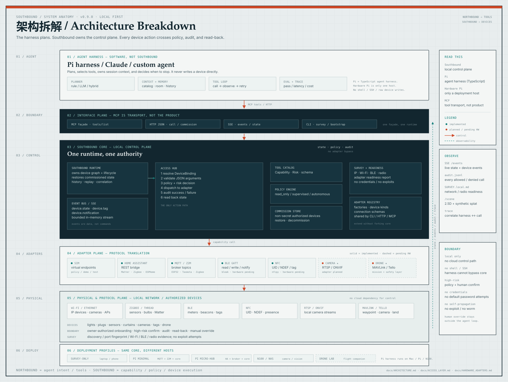

# Architecture Breakdown

完整的 Southbound 分层拆解图：**Agent harness（规划）→ MCP/HTTP 接口 → Southbound control plane → adapters → physical devices**。图里也标出了本地安全边界、Pi/服务器部署 profile、BLE/NFC 已实现状态，以及 camera/drone 的计划位置。

也可直接打开 [PNG 版本](ARCHITECTURE_BREAKDOWN.png)。

## 读图顺序

1. **Agent harness（软件）**：Pi harness / Claude / 其他 agent，只做规划、上下文和工具选择，不直接写设备。
2. **Interface plane**：MCP 是工具传输；HTTP/SSE 负责调用和事件；CLI 负责 survey/bootstrap。
3. **Southbound core**：`SouthboundRuntime` + `AccessHub` 是唯一动作路径，包含参数校验、策略、审计、回读、CommissionStore 和 Tool Catalog。
4. **Adapter plane**：Sim、Home Assistant、MQTT/Z2M、BLE、NFC 已实现；Camera、Drone 为计划中的 adapter。
5. **Physical plane**：Wi-Fi/Ethernet、Zigbee/Thread、BLE、NFC、RTSP/ONVIF、MAVLink/Tello。
6. **Deployment profiles**：survey-only、Pi minimal、Pi micro-hub、N100/NAS camera edge、drone lab；同一套 core，不同硬件宿主。

关键边界：**MCP 不是 Southbound 本体；Pi harness 是 TypeScript agent harness；硬件 Pi 只是部署宿主。**
