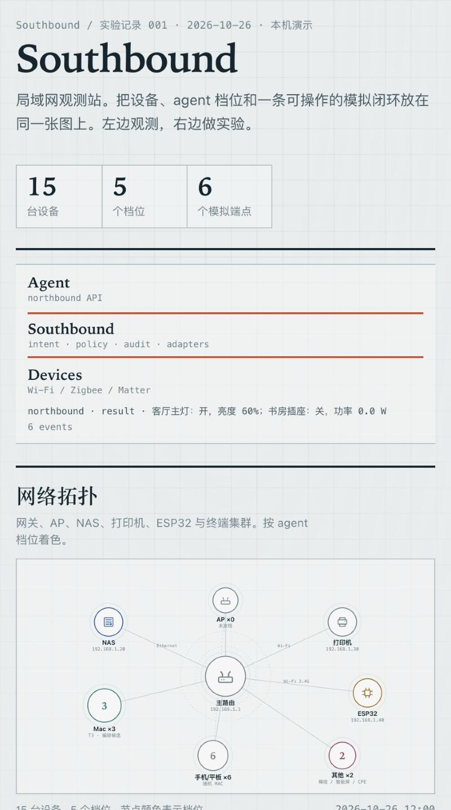

# Demo

没有硬件也能看到完整效果：局域网观测 → northbound 意图 → southbound 动作 → 状态回读 → 受控接入。

## 启动

```bash
git clone https://github.com/alexyyyander/southbound.git
cd southbound
python3 -m southbound serve
```

打开 `http://127.0.0.1:8765/`。



## 1. Agent 控制台

在 Agent 控制台输入：

```text
打开客厅灯并关掉书房插座
```

可以看到：

- flowbar 上出现 `intent → command → state → result`；
- Agent trace 展示 `plan → sim.find → sim.act → sim.get`；
- 客厅灯 tile 变为开，书房插座 tile 变为关；
- `data/audit.jsonl` 写入本次动作。

示例结果：

```text
northbound · intent · 打开客厅灯并关掉书房插座
southbound · 客厅主灯 · turn_on ✓
northbound · state · 客厅主灯 · turn_on
southbound · 书房插座 · turn_off ✓
northbound · state · 书房插座 · turn_off
northbound · result · 客厅主灯：开，亮度 60%；书房插座：关，功率 0.0 W
```

## 2. 受控接入

点击“模拟端点”下方的 **＋ 接入设备**：

1. Adapter 选 `sim`；
2. 名称填 `演示传感器`；
3. 类型 `sensor`，房间 `客厅`；
4. Capabilities 留 `read`；
5. 勾选确认；
6. 提交。

flowbar 会出现：

```text
northbound · commission · 演示传感器
southbound · commission · 演示传感器 ✓
northbound · ready · 演示传感器 · 1 capabilities
```

新的虚拟端点在模拟端点区域出现。它不是内置设备，右下角有“移除”按钮；点击会发出 `decommission` 事件并撤销绑定。

## 3. CLI Demo

```bash
python3 -m southbound intent "把客厅灯调到 35% 并打开窗帘"
```

```bash
python3 -m southbound onboard --adapter sim \
  --id demo_sensor \
  --name 演示传感器 \
  --kind sensor \
  --room 客厅 \
  --capabilities read \
  --confirm
```

```bash
python3 -m southbound access
```

```bash
python3 -m southbound call demo_sensor read
```

```bash
python3 -m southbound decommission demo_sensor --confirm
```

CLI 使用 `data/commissioned.json` 持久化已授权设备；新进程启动时会恢复。

## 4. MCP Demo

```bash
python3 -m pip install -e .
claude mcp add --scope project southbound -- python3 -m southbound.mcp_server
```

在 Claude Code 里批准后，可以调用：

- `iot_tool_catalog`
- `iot_call`（如 `living_light` / `set_brightness` / `{"brightness": 30}`）
- `iot_commission`（`adapter=sim`，`kind=sensor`，`confirm=true`）
- `iot_decommission`

## 5. 常见问题

**面板打不开？** 确认 `8765` 端口没有被占用；服务只绑定 `127.0.0.1`。

**mDNS/SSDP 为空？** macOS 可能需要在“系统设置 → 隐私与安全性 → 本地网络”里放行终端/Claude。

**没有设备数据？** 先运行 `python3 -m southbound discover --sweep`；面板缺失 `inventory.json` 时仍可运行模拟器部分。

**接入后 CLI 看不到设备？** CLI 和已运行的 dashboard 是两个进程；CLI 会写 `data/commissioned.json`，dashboard 刷新/重启后恢复。独立 runtime service 是后续工作。

**接入失败？** 检查 adapter 是否可用、是否传了 `confirm=true`、HA 是否设置了 `HA_TOKEN`、MQTT 是否安装了 `paho-mqtt`。

## 相关文档

- [受控接入](ONBOARDING.md)
- [接入层](ACCESS_LAYER.md)
- [协议](PROTOCOL.md)
- [架构](ARCHITECTURE.md)
