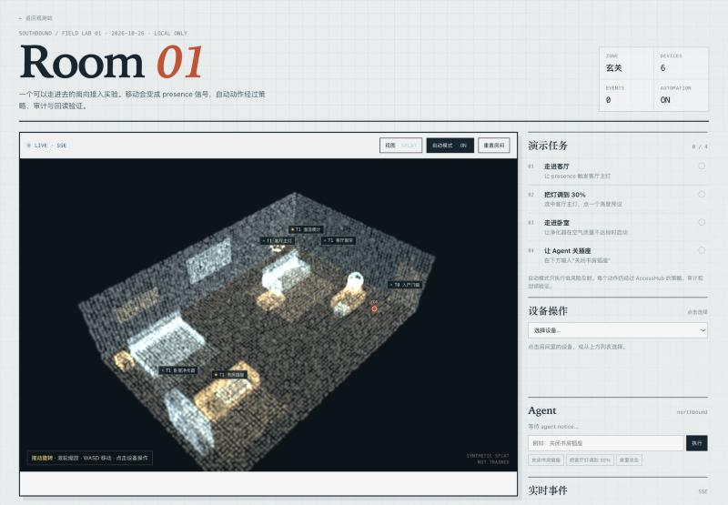

# 2.5D Scene & 3DGS Visual Layer

`/scene` ships two views over one authoritative control map:

- **2.5D control map**: deterministic positions, click targets, policy, audit,
  navigation, and read-back verification.
- **Synthetic splat preview**: a dependency-free WebGL point-splat renderer
  generated from the same room geometry, for judging the visual direction
  before capturing a real room.

A later captured 3D Gaussian Splatting (3DGS) asset can make the room
photoreal without changing the control plane.

## Current 2.5D model

```text
browser avatar (x, y)
        │ POST /api/scene/presence
        ▼
SceneController ── presence event ──► EventBus / SSE
        │
        ├─ low-risk reflex rule (living light / bedroom purifier)
        ▼
SouthboundRuntime.call() → AccessHub → policy → audit → adapter
        │
        ▼
state read-back → automation.verified / automation.failed → agent.notice
```

- Room is `12 × 8` metres; zones are entry, living, bedroom, study.
- Six built-in simulator devices have fixed anchor coordinates in
  `southbound/scene.py` (`PLACEMENTS`).
- The avatar is a proxy for a person or a robot; it is not camera tracking.
- Only low-risk actions run in the scene's automatic mode. High-risk devices
  still require policy and confirmation.

## Synthetic splat preview (shipped)



Switch **视图 2.5D** to **SPLAT** in the scene bar. This is intentionally
labeled *Synthetic splat / not trained*:

- `southbound/web/splat.js` samples the floor, walls, window, door, furniture,
  and pendant light into roughly point-splat primitives.
- A small WebGL2/WebGL1 shader renders soft, additive points under a
  perspective camera; depth is intentionally not used so the cutaway room
  reads like a radiance splat rather than a solid mesh.
- Drag to orbit and scroll to zoom. Device hotspots and the avatar marker are
  projected with the same view-projection matrix.
- Clicking a hotspot selects the same `device_id`; movement and automation
  still go through `SceneController` and `AccessHub`.
- No external viewer library, no `.splat` asset, and no network request.
- If WebGL is unavailable, the 2.5D canvas remains the fallback and the view
  toggle disables.

This preview validates the visual direction, not the final 3DGS quality. It
is a synthetic point cloud, so it cannot reproduce captured textures,
view-dependent reflections, or fine geometry.

## 3DGS as a skin, not a second brain

Keep the 2.5D map authoritative:

| Concern | Owner |
|---|---|
| Avatar/zone coordinates, collisions | 2.5D scene |
| Device anchors and hit targets | 2.5D scene |
| Rules, policy, audit, verification | `SceneController` + `AccessHub` |
| Photoreal walls, furniture, light | optional 3DGS layer |
| Camera orbit / visual effects | optional 3DGS layer |

A device placement can later grow an optional `splat_anchor`:

```json
{
  "device_id": "living_light",
  "x": 3.4,
  "y": 2.0,
  "z": 2.55,
  "splat_anchor": {"x": 1.83, "y": 2.11, "z": -0.42}
}
```

The UI maps a click on the splat viewer's device hotspot back to
`device_id`, then calls the same northbound API.

## Capture and training pipeline

1. Capture a short, well-lit walkthrough of the room (video or photos).
2. Reconstruct camera poses with COLMAP.
3. Train with nerfstudio (`splatfacto`) or gsplat.
4. Export `.splat` or compressed `.ply`; keep a poster frame and a low-res
   preview for first load.
5. Place assets in `data/scene/` or Git LFS; never commit raw home footage
   to a public repository.
6. Map world coordinates to the splat's coordinate frame; store the transform
   with the asset, not in ad-hoc JavaScript.
7. Validate device hotspots against the 2.5D anchors before shipping.

## Browser plan

- The 2.5D canvas is the default and always available.
- The shipped synthetic splat view is the switchable WebGL preview.
- For a captured 3DGS asset, use a WebGL2 splat renderer behind the same
  toggle; 2.5D remains the fallback.
- Progressive loading: low-res splat first, then full asset; show a progress
  state on the stage.
- Keep the HUD, task list, device inspector, SSE feed, and automation controls
  unchanged.
- Respect `prefers-reduced-motion` and cap device pixel ratio.

## Performance and safety

- Target a few hundred thousand splats for mobile; desktop can use more.
- Preload only when the user chooses the realistic view.
- 3DGS can reveal a real floor plan; obtain consent, blur sensitive items,
  and do not publish raw captures.
- A visual hit target must never bypass `AccessHub`; it is an input to the
  same policy/audit path.
- The 2.5D map stays available when WebGL or the asset is unavailable.

## Not implemented yet

The synthetic splat preview is shipped, but a real captured 3DGS asset is not.
Capture, COLMAP/nerfstudio/gsplat training, asset hosting, compression, and
progressive loading remain a separate phase; they should not gate the
control-layer demo.
