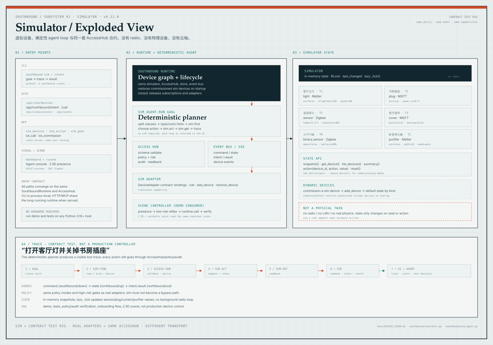

# Simulator Breakdown

Simulator 子系统的独立拆解图：它不是一个硬件模拟器或数字孪生，而是一个**契约测试台**——用同一套 `AccessHub`、策略、审计和 capability schema 驱动六个内存中的虚拟设备。

也可直接打开 [PNG 版本](SIMULATOR_BREAKDOWN.png)。

## 读图顺序

1. **Entry points**：CLI、HTTP、MCP、Dashboard、`/scene` 都汇聚到同一个 `SouthboundRuntime`；CLI 是进程内的，HTTP/MCP 在常驻服务中共享状态。
2. **Runtime + deterministic agent**：`sim_agent.run_goal()` 拆目标、匹配设备、选择动作、调用 `_AgentRuntime.act()`，再回读状态并生成 trace；不需要 LLM。
3. **AccessHub**：参数校验、策略/风险、审计、回读；SimAdapter 只是 adapter 实现，不能绕过 AccessHub。
4. **Simulator state**：六个内置虚拟设备，加上受控 onboarding 的动态设备；`_tick()` 惰性更新传感器/功率/窗帘/净化器；状态在内存中，`RLock` 保护。
5. **Trace**：goal → sim.find → AccessHub → sim.act → sim.get → SSE/UI。每个步骤都可被面板、测试和 MCP 观察。

Sim 的边界：没有 radio、没有局域网扫描、没有真实物理、没有生产安全认证。它用于 demo、测试策略/审计、验证 onboarding 和 2.5D 场景；真实设备到达后替换 adapter，AccessHub 合约不变。

完整系统图见 [Architecture Breakdown](ARCHITECTURE_BREAKDOWN.md)。
